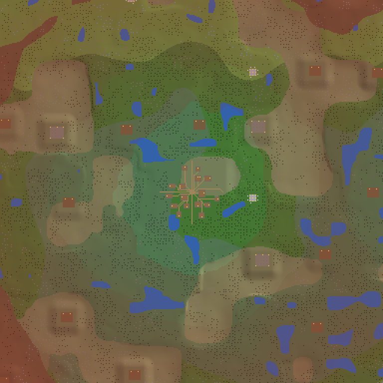
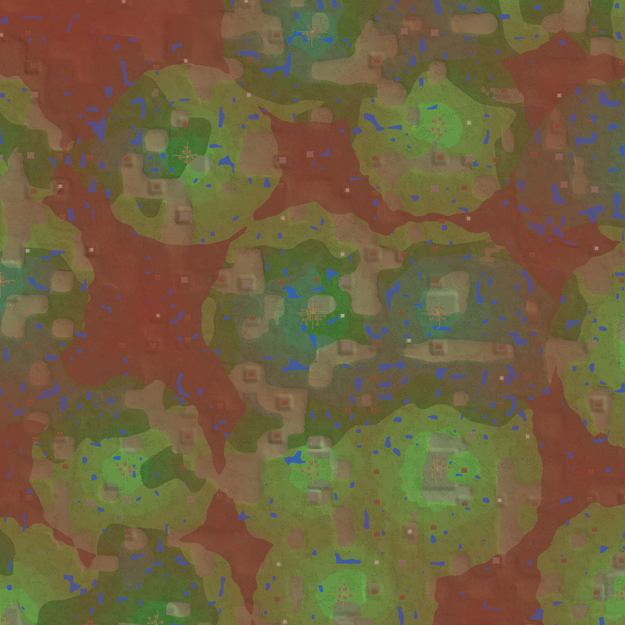

# Epacenur

A RuneScape-style skilling game for **Unity 6**. You can play top down, clicking tiles, or in first person.
You start in a **procedurally generated world**: a city with a bank, a general store and a chapel, on safe ground with forests
and ponds round it, and beyond, the wilderness, more dangerous the further you go, until you near the next town. There's also a separate **dev plot** for testing skills, reached from the dev tools (F1).
Skills so far: **Woodcutting**, **Mining**, **Smithing**, **Firemaking**, **Fishing**, **Cooking**, **Prayer**, and melee combat
(Attack, Strength, Defence and Hitpoints) against goblins that fight back.

There are no art assets: everything is built from Unity's primitive shapes when you press Play,
so there are no scenes or prefabs to wire up.

## Opening the project

1. Install [Unity Hub](https://unity.com/download) and a **Unity 6** editor (6000.0 LTS).
2. In Unity Hub: **Add → Add project from disk** and pick this folder. If Hub says the exact editor
   version isn't installed, pick any Unity 6 version you have.
3. When the import finishes, press **Play**. The first time it opens, the project creates
   `Assets/Scenes/DevArea.unity` for you. The game also starts from any scene, including Unity's default one.
4. Commit the `.meta` files Unity generates on first import.

The **Epacenur** menu has *Build Windows Game*, *Open Dev Area Scene* and *Delete Saved Progress* (every character and world).

## Main menu

The game opens on the main menu:

- **Characters** (left): pick one, or type a name (up to 12 letters, digits and spaces) and press **Create**.
  Each shows its total level, combat level and when it was last played. A character's skills, items, bank, tool belt and
  equipment go with them into any world.
- **Worlds** (right): pick one, or make one with a name and a **seed** (any whole number; **Dice** rolls one). The same seed
  always makes the same overworld. Each world remembers where each character stood in it, and the items left on its ground;
  a character new to a world starts in its first town.
- **Delete** asks for a second click. Deleting a world keeps the characters. There's always at least one world.
- **Play** (or Enter) starts. In the game, **Log out** (top right, two clicks) saves and goes back to the menu.
- A save from before characters existed becomes a character called *Adventurer*, in the world *Epacenur* (seed 2024).

## Controls

| | Tile mode (default) | First person |
|---|---|---|
| Move | Left-click a tile to walk there (pathfinding), or **WASD** | **WASD** |
| Run | Hold **Shift** while walking | Hold **Shift** |
| Chop a tree | Left-click it: you walk next to it and chop automatically until it becomes a stump or your inventory is full | Look at it and **left-click once per chop** (within reach) |
| Camera | Arrow keys or middle-drag to rotate, scroll to zoom | Mouse look. **Esc** frees the mouse; click the view to grab it again |
| Use the bank | Left-click the bank booth (by spawn): you walk up to it and the bank opens | Look at it and left-click (within reach) |
| Trade with the shop keeper | Left-click him (beside the bank booth) | Look at him and left-click |
| Attack a goblin | Left-click it: you walk up and keep hitting it until it dies | Look at it and left-click once per hit (within reach) |
| Pick up an item on the ground | Left-click it ("Take"): you walk onto its tile and pick it up | Look at it and left-click (within reach) |
| Switch view | **V** | **V** |
| Show / hide the chat box | **C** (or the button over it) | **C** |
| Show / hide the inventory panel | **B** (or the button over it) | **B** |

- **Right-click menu**: right-click anything for RuneScape's "Choose Option" menu, listing every option for
  what's under the cursor, e.g. *Attack Goblin (level-2)*, *Take Coins (12)*, *Walk here*, *Examine Goblin*, *Cancel*.
  Items lying on the tile are all listed. The top option is what left-click does, and the top-left text shows it
  ("Chop down Tree / 2 more options"). Inventory items get Wield / Wear, Drop and Examine. Worn items get Remove and Examine.
  In first person, right-click lists the options for what you aim at (within reach), and the mouse is grabbed again
  once you choose. The menu closes when you pick something, click elsewhere, or move the mouse away from it.
- **Panel tabs**: **Inv** (inventory and money pouch), **Worn** (equipment), **Tools** (tool belt), **Pray** (prayers), **Magic** and **Skills**.
- **Screen layout**: the chat box is at the bottom left, the abilities with your health and prayer over them in the middle at the
  bottom, and the side panel at the bottom right. Put the chat box or the panel away for a clearer view (it comes back on its own
  when you open a bank, shop or make window).
- **Walking and running**: walking is about RuneScape's pace (2 tiles a second on a clicked path). Hold **Shift** to run:
  4.4 tiles a second on a path, 5.4 with WASD, faster than walking ever was before. The top-left shows "Running" while you hold it.
  Goblins chase faster than you walk, so run to get away.
- **Inventory**: 28 slots, one log per slot. Click a sword or shield to wield it. Click any other item and then another
  slot to swap them. Shift-click an item to **drop it on the ground** (or use Drop in its right-click menu).
- **Skills** tab: laid out like RuneScape 3's skills panel. It's a grid of cells, each with the skill's icon and its level
  shown twice, stacked (current over base; they match until there are boosts). Hover a cell for its xp, the next level and
  a progress bar. The footer shows total level, combat level (OSRS formula with melee and Prayer; no Ranged or Magic yet) and total xp.
- **H** shows or hides the help, and **F1** opens the dev tools.
- Progress (skills, inventory, bank, worn equipment, attack style, position) saves every 15 s and when you quit.

## The overworld

*384 × 384 tiles round the start (seed 2024, as the world map draws it): Epacenur in the middle on its safe ground (green), the
wilderness round it (tinted red, deeper the more dangerous), shrines (dotted squares), camps (brown), ponds, forests, highlands (tan).*

*Further out: towns and cities in their safe rings (green), the wilderness between them, deepest (dark red) where towns are far apart.*

- **It never ends.** The world is worked out from a seed (`World.Seed`) one tile at a time, so the same place always comes out the same.
  Only the area round you exists: it's built in 16 × 16 tile **chunks** as you walk (5 chunks each way) and taken down behind you,
  hidden by the fog. Felled trees and lit fires don't survive being unloaded.
- **Regions** of 64 × 64 tiles each hold a town or city, a **camp** (about 1 in 5: a clearing with tents and its occupants),
  a shrine, a quarry or plain countryside.
- **Towns and cities lie far apart**: at most one in each cell of 5 × 5 regions (320 tiles), somewhere near its middle, so
  neighbours are at least 3 regions apart, and about 1 cell in 5 has none, leaving wide wilds. About 1 in 4 is a **city**: more
  houses, spread wider. **Epacenur**, where you start, is a city. Each has a square, a **bank**, a **general store**, a **chapel**
  with an altar, a **smithy**, a **workshop** and **houses**, joined by dirt roads, and its own made-up name.
- **Safety and the wilderness**: within 48 tiles of a town's square (80 for a city) is **safe**. Beyond, the **wilderness**
  begins: **wilderness level 1** at the edge, one more every 6 tiles further from the nearest town, up to 60, then falling again
  as you near the next town. The rings' edges wander a little. Under the minimap you see **Safe** (and which town) or the
  **wilderness level** (yellow, turning red), and the biome; the chat tells you when you leave a town's safety, go into the
  **deep wilderness** (level 24 and up) and come back. Deeper in the wilderness the **monsters are fiercer** and the **resources
  better** (see Tiers). On the safe ground there are only chickens, cows and goblins, none of them aggressive.
- **Biomes**: the country is **meadow** (open, flax fields, few trees), **woodland** (thick forest), **marsh** (wet, with many
  ponds), **highlands** (up in the hills: rocky, few trees) or, deep in the wilderness, **wasteland** (scorched, rocky, the odd
  yew). Each has its own ground colour, browning the deeper into the wilderness you are, and its favourite trees and rocks:
  willows in marshes, oaks and maples in woodland, coal and mithril in the highlands, yews and adamantite in the wasteland.
- **Shapes**: the noises behind it all are layered (fine detail on big shapes) and warped (winding, not round blobs), and never
  repeat however far you go.
- **Quarries** (about 1 in 11 regions): an open gravel pit with rows of ore rocks you can walk between, spoil heaps in its corners
  and a mine cart heaped with ore. Most of a quarry's rocks are one ore (the one that suits its wilderness level; it's
  named on the world map, e.g. "Iron quarry"); the rest are a mix. No monsters live there.
- **Trees** each have their own shape: plain trees round, oaks broad and lumpy, willows hung with long fronds, maples in autumn
  reds and golds, yews in dark tiers. All have roots flaring into the ground.
- **Countryside**: **forests** where a smooth noise is high, **rocky ground** with rocks you can mine, and **ponds**, each with a
  moving **fishing spot** on its shore. Trees and rocks never touch, even diagonally, water keeps clear of roads, and ponds are
  shaped so they never shut in an island; camps, shrines and quarries only go on dry ground. So you can always walk round
  everything: the tests check that nothing walkable is shut in, on several seeds.
- **Hills**: the ground rises and falls in rolling hills (up to about 10 units high, higher in some stretches of country than
  others, with small bumps on top). Towns, camps, shrines, quarries and ponds sit on level ground that blends into the hills
  round them, and ponds only form in low country. The slopes are gentle enough to walk anywhere the tile grid lets you; the minimap and
  world map shade the hills. (`Overworld.Elevation`; each chunk's ground is a mesh over it.)
- Far from the start, numbers get big; the game moves its **origin** with you (floating origin), so it plays the same a million tiles out.
- **Dev tools (F1)**: **Teleport to dev plot** takes you to the dev plot, a separate small map (with its Mining, Goblins, Fishing and
  Firemaking plots, bank booth, shop, altar, furnace and anvil). **Teleport to main world** brings you back. Saves remember which map
  you're on. Saves from before the endless world start in the town square.
- The generator is `Assets/Scripts/Core/World/Overworld.cs` (towns: `WorldGen.cs`); the 3D side is `Assets/Scripts/Runtime/World`.

## Mining and Smithing (dev plot)

- The dev plot's first plot is now **Mining**: rows of **copper** and **tin rocks**. **Mine** one (you need a **bronze pickaxe**, in your
  backpack or on the tool belt). In tile mode you keep swinging until you get the ore; in first person each click is one swing.
  Each success gives one ore and **17.5 Mining xp**, and the rock goes grey and empty for 2.4 s before its ore comes back, as in OSRS.
  About 2 swings in 5 succeed at level 1, rising with level.
- A **furnace** stands next to the altar, by the dev plot's spawn. **Smelt** it to turn **1 copper ore + 1 tin ore** into a **bronze bar**
  (6.2 Smithing xp), one every 4 ticks, as many as your ores make. Walking away stops it.
- An **anvil** stands next to the furnace. **Smith** it to open the Smithing window, then press **1**, **5** or **All**
  (or right-click a row). You need a **hammer**.

| Item | Bars | Smithing level | Xp | Defence bonus |
|---|---|---|---|---|
| Bronze full helm | 2 | 7 | 25 | +4 |
| Bronze platelegs | 3 | 16 | 37.5 | +8 |
| Bronze platebody | 5 | 18 | 62.5 | +15 |

- Wear them from the backpack like the sword and shield: the helm goes on your head (with a face guard and crest), the platebody
  over your tunic, and the platelegs on your legs. Their defence bonuses make goblins miss more.
- The pickaxe and hammer are on every new character's tool belt (older saves get them once), and the shop sells both for 1 gp.
- The dev tools add **5 copper + 5 tin**, **5 bronze bars**, or a **pickaxe + hammer**.
- The trees that were on the dev plot are gone; the main world's forests have plenty. Content: `Assets/Scripts/Content/Mining` and
  `Assets/Scripts/Content/Smithing`. Copper and tin rocks also grow on rocky ground in the overworld.

## Money pouch

Coins live in a **money pouch** shown under the inventory, as in RuneScape 3, so they never take a backpack slot.

- Coins you get go straight into the pouch: shop sales, coins picked up off the ground, coins withdrawn from the bank, dev tools.
  It holds up to **2,147,483,647**; anything past that lands in the backpack as a stack.
- Shops spend from the pouch first, then from any coins in your backpack.
- Right-click the pouch to **Withdraw-1 / 10 / 100 / 1,000 / All** coins into your backpack as a stack, for example to drop them.
  Click a coin stack in the backpack (or right-click, **Add to pouch**) to put it back.
- At the bank, click the pouch or press **Deposit money pouch** to bank every coin in it. **Deposit inventory** leaves the pouch alone.
- The amount uses RuneScape's colours: yellow below 100K, white below 10M, green above. Left-click it to examine.
- Saves from before the pouch move their coins into it when loaded.

## Tool belt

The **Tools** tab is RuneScape 3's tool belt. Tools on it are used automatically, as if they were in your backpack,
so they don't take up slots.

- Click a tool in your backpack, or right-click it and choose **Add to tool belt**, to move it onto the belt. It stays there for good:
  it can't be taken off or dropped, and a second copy stays in the backpack.
- It can hold the **bronze hatchet** (woodcutting), the **tinderbox** (firemaking) and the **small fishing net** (fishing). The tab shows every tool it can hold,
  with the ones you have in full colour.
- Tools still work from the backpack too. The list of tools is `ToolBelt.Tools` in `Assets/Scripts/Core/ToolBelt.cs`.

## Bank

- The bank booth stands just north-east of spawn. Clicking it opens the bank window.
- Each kind of item takes **one bank slot and stacks there**, even items like logs that take a slot each in the
  inventory. The bank has 400 slots. Counts show RuneScape style: yellow below 100K, then K, then M in green.
- While the bank is open, click an inventory item to deposit it, or click a bank slot to withdraw. The **1 / 5 / 10 / All**
  buttons set how many. Shift-click moves all of it, and right-click lists Deposit-1 / 5 / 10 / All (Withdraw-… in the bank). **Deposit inventory** empties your backpack in one go.
  You only get as many items as you have free inventory slots.
- The bank closes with **X**, **Esc**, or when you walk away from the booth. It's saved along with everything else.

## Shop

- The **shop keeper** stands two tiles east of the bank booth. "Trade" opens the **Dev Area General Store**.
- It stocks 5 each of a **Tinderbox** (1 gp), a **Bronze sword** (26 gp), a **Wooden shield** (20 gp) a **Small fishing net** (5 gp) and a **Bronze hatchet** (16 gp). The stock is in
  `ShopsModule` in `Assets/Scripts/Content/Shops`.
- Click an item to buy it, using the **1 / 5 / 10 / 50** buttons for how many. Shift-click buys 50. Right-click for Value, Buy 1 / 5 / 10 / 50 and Examine (your own items get Value and Sell …).
- While the shop is open, click your own items to sell them. It's a general store, so it buys anything but coins, for 40% of the item's
  value (logs sell for 1 gp). Items you sell show up in its stock.
- Stock drifts back to normal by one every 6 seconds, and items players sold slowly disappear.
- New saves start with **100 coins**. The dev tools can add 1,000 more.
- The sword and shield can be wielded, the tinderbox lights fires and the net catches fish (see below).

## Items on the ground

- Dropped items land on your tile and show as small 3D models: logs, a coin pile, a tinderbox, a sword, a shield.
  Coins dropped on the same tile join one pile.
- Click one to walk there and pick it up. In first person, look at it and click. Hovering shows "Take Logs" or "Take Coins (12)".
- They don't block walking, and they **never disappear**: they stay until someone picks them up, even while that part of
  the world isn't loaded, and they're saved with the world (so they're still there next session).

## Equipment and combat

- The **Worn** tab is laid out like RuneScape's equipment screen: head; cape, neck and ammo; weapon, body and shield; legs;
  gloves, boots and ring. Click a worn item to take it off (you need a free inventory slot). Below that are
  your bonuses and the weapon's **attack styles**.
- **Bonuses work like OSRS**: attack and defence bonuses for **stab, slash and crush**, plus melee **strength**. Your hit
  chance uses your attack bonus for the style's attack type against the monster's defence against that type; a monster's
  hits use your defence against its type (goblins crush).
- **Weapons** each have a kind with its own styles, and a **speed**: sword and dagger (Stab, Lunge, Slash, Block), scimitar
  (Chop, Slash, Lunge, Block), mace (Pound, Pummel, Spike, Block), two-handed sword (Chop, Slash, Smash, Block). Each style
  says which skill it trains (hover it). With no weapon you fight **unarmed** (Punch, Kick, Block); no sword or shield needed.
- Bronze weapons, all smithed at the anvil: **dagger** (fast stabs), **mace** (crush, 3 s), **sword**, **scimitar** (slash),
  **2h sword** (strong but slow, 4.2 s, and **two-handed**: wearing it takes your shield off, and the other way round).
  Bronze armour and the wooden shield defend differently against each type.
- The **Goblins** plot, in the middle, has 4 goblins (level 2, 5 hitpoints) that wander around it. They leave you alone
  until you attack, then **fight back**: they chase you (but not far from their plot) and hit you every 4 ticks. A goblin's
  max hit is 1, and its hit chance is rolled against your Defence level and bonus, Defence prayers and attack style
  (Defensive adds 3), using OSRS's formulas. They give up if you run more than 12 tiles away or leave the area round their plot.
- **Auto retaliate**: if a goblin hits you while you're standing idle in tile mode, you fight back.
- Hits use RuneScape's melee formulas: hit chance from your Attack level and bonus against the goblin's defence, and
  max hit from Strength. With the sword, a hit every 4 ticks (2.4 s). Red hitsplats show damage, blue ones a miss,
  and a health bar shows over a goblin you're fighting.
- Each damage point gives 4 xp in the chosen style's skill plus 1.33 Hitpoints xp. Hitpoints starts at level 10.
- A dead goblin always drops **bones**, plus **1–30 coins** (weighted towards small amounts), and respawns after 15 s.
  Its stats and drops are in `CombatModule` in `Assets/Scripts/Content/Combat`.

## Tiers: deeper in the wilderness, better things

The deeper into the wilderness you go (its level: how far you are from the nearest town's safe ground), the better the
trees, rocks and fishing, and the tougher the monsters. Where things appear is data: each tree, rock, fishing spot, altar
and monster has spawn rules (from and to which wilderness level, how likely, and for some, a biome they like) in its
content module.

| | Safe ground round towns | Deeper in the wilderness (from level) |
|---|---|---|
| **Trees** | normal (1), oak (15) | willow (30, level 3; anywhere in marshes), maple (45, 10; 6 in woodland), yew (60, 20; 18 in wasteland) |
| **Rocks** | copper and tin (1) | iron (15, level 2), coal (30, 6; 3 in highlands), mithril (55, 16; 12 in highlands), adamantite (70, 28; 26 in wasteland) |
| **Fishing** | net: shrimps (1), anchovies (15) | lure (fly fishing rod + feathers): trout (20), salmon (30), from level 2; cage: lobster (40); harpoon: tuna (35), swordfish (50), from 10 |
| **Monsters** | chickens, cows, goblins | wolves (level 6), wizards (8), bandit camps (10), bandits (14), hill giants (18) |

- **Metals**: bronze, iron, steel, mithril, adamant. Smelt bars at a furnace (iron ore alone; steel, mithril and adamant
  also need 2, 4 and 6 coal), then smith a dagger, hatchet, mace, sword, scimitar, pickaxe, full helm, 2h sword, platelegs
  and platebody from each at the anvil (OSRS levels: an iron platebody needs 33, an adamant one 88).
- **Requirements**: steel needs 5 Attack (weapons) or Defence (armour), mithril 20, adamant 30. Hatchets and pickaxes need
  Woodcutting / Mining 6 (steel), 21 (mithril), 31 (adamant). **Better tools gather faster** (each tier 20% more chance),
  and the best one you can use is picked automatically.
- **Logs** of every tree burn (oak 15, willow 30, maple 45, yew 60) for more xp and longer. **Fish** heal more the better
  they are (trout 7 ... swordfish 14) and stop burning later (lobster at 74). Cows give beef and hides, chickens meat and
  feathers (the general store sells feathers and the new fishing tools too).
- **Monsters**: chickens and cows are harmless; **wolves, bandits and hill giants are aggressive**: they attack you if you
  come within 4 tiles, unless your combat level is more than twice theirs. Hill giants drop **big bones** (15 Prayer xp),
  coins and the odd piece of iron or steel; bandits coins and iron weapons. Camps deeper in the wilderness are bandit camps.
- The dev plot's mining area has every kind of rock, its pond every kind of fishing spot, and the dev tools give bars of
  every metal, fishing gear and adamant gear.

## Ranged and Fletching

- **Ranged** is a combat skill: wield a **bow** and wear **arrows** in the ammo slot, then attack from a distance (you walk
  only until the monster is in range). Shortbows reach 7 tiles and fire every 4 ticks; longbows reach 9 but fire every 6.
  Styles: **Accurate** (+3 Ranged), **Rapid** (a tick faster) and **Longrange** (2 tiles further; xp split with Defence).
  Accuracy uses your Ranged level and the bow's ranged attack against the monster's ranged defence; max hit uses Ranged
  and the arrows' ranged strength. Combat level counts the better of melee and ranged, as in OSRS.
- Each shot uses an arrow; **80% land on the ground** under the target to pick up again. Bows are two-handed and can only
  fire arrows up to their tier: a plain bow bronze and iron, oak up to steel, willow mithril, maple and yew adamant.
  Bows need Ranged 5 (oak), 20 (willow), 30 (maple), 40 (yew); arrows the same as the metal's armour.
- **Fletching** (all made in your hands: **use** one item on another to open the make window):
  - a **knife on logs**: arrow shafts (15 from normal logs, up to 75 from yew) or an **unstrung shortbow / longbow**;
  - a **bowstring on an unstrung bow**: the bow (the same xp again);
  - **feathers on arrow shafts**: headless arrows, 15 at a time;
  - **arrowtips on headless arrows**: arrows, 15 at a time. Smith arrowtips at the anvil, 15 from a bar.
  OSRS levels: shortbow 5, longbow 10, oak 20/25, willow 35/40, maple 50/55, yew 65/70; arrows bronze 1 ... adamant 60.
- The general store sells knives, bowstrings, shortbows and bronze arrows. The melee abilities need a melee weapon (or none).

## Crafting

- **Flax** grows in fields in open country (and on the dev plot's Flax plot): **Pick** it, no tool needed.
- Every town now has a **workshop** with a **spinning wheel** and a **tanning rack**, and a **smithy** with a **furnace**
  and an **anvil**, so you can smelt and smith out in the world too.
- **Spin** flax into **bowstrings** at the spinning wheel (Crafting 10, 15 xp): no more buying them for your bows.
- **Tan** cowhides into **leather** at the tanning rack: 1 coin each, all at once.
- **Sew leather armour** with a **needle** and a **thread** (use the needle on leather; each item uses a thread). OSRS levels
  and xp: gloves 1, boots 7, coif 9, vambraces 11, body 14, chaps 18. Leather is light armour that suits rangers: the coif,
  vambraces, body and chaps add some ranged accuracy as well as defence (and defend best against arrows).
- The general store sells needles and thread.

## Runecrafting and Magic

- **Rune essence** rocks are big pale boulders with glowing crystals, ringing every altar just outside its standing stones
  (and on the dev plot's Runecrafting plot). Mine them with
  any pickaxe (Mining, 5 xp each); they **never run out**.
- **Altars** stand in rings of standing stones out in the wilds (shrines, on the world map by name). **Craft-rune** at one
  (or use essence on it) to turn all your essence into its runes at once. OSRS levels and xp: air 1, mind 2, water 5,
  earth 9, fire 14, body 20, nature 44, law 54. Better altars lie deeper in the wilderness. **An air altar is always in the region just
  east of Epacenur**, so you can start straight away.
- **Magic** (the new Magic tab): spells use runes, at OSRS levels.
  - **Combat spells**: Wind, Water, Earth and Fire **Strike** (levels 1-13) and **Bolt** (17-35). Click one to **autocast**
    it: from then on attacking a monster casts it from up to 10 tiles away, every 3 seconds, using up its runes (click it
    again to fight with your weapon). Spells roll your Magic and magic attack bonus against the monster's Defence and magic
    defence, and give their xp even when they miss, plus 2 Magic xp per damage. *One change from OSRS: bolts take a body rune
    where OSRS takes a chaos rune.*
  - **Home Teleport**: free, takes 10 seconds, stand still (moving or being hit stops it); not within 10 seconds of a fight.
  - **Town Teleport** (25; 1 fire, 3 air, 1 law): to the nearest town.
  - **Low** (21) and **High Level Alchemy** (55): click the spell, then an item: it turns into 40% / 60% of its value in coins.
- **Staffs**: a **staff of air / water / earth / fire** is an endless supply of its element's runes (and +10 magic attack).
  The general store sells a plain staff, and air and mind runes.
- **Wizard robes** (hat, robe top, skirt) add a little magic attack and defence.
- **Dark wizards** gather in the wilds a little way out and cast spells at you from range (magic defence helps against
  them). They drop runes, robes and staffs.
- Magic counts toward your **combat level** like Ranged: 0.325 of 1.5 x your Magic, if it's your best style.
- Dev tools: a **Magic kit** (staff of air, robes, runes of every kind).

## Death and gravestones

- When you die you **keep your 3 most valuable items** (by value, counting each item of a stack, from your inventory and
  what you wear). Everything else goes into a **gravestone** where you fell. Your money pouch and tool belt are always safe.
- You wake up in the **nearest town** (on the dev plot: at its start) with full health and prayer.
- Get back to the gravestone within **15 minutes** (of play in that world; the time shows under the minimap) and
  **Reclaim items** to take back what fits. After that it **collapses** and your items are left on the ground where it
  stood (they stay there until picked up). Dying again while you have a gravestone collapses the old one.

## Using items, and Make-X

- **Use**: every item has it. Pick an item (Use, or just click an item that has nothing else to do), then click another item
  or something in the world: a **tinderbox on logs** lights them, **raw fish on a fire** or **ore on a furnace** opens the make
  window for that item, **bones on an altar** are offered for 3.5 times the Prayer xp of burying, an item on a **bank booth**
  deposits all of it, a hatchet on a tree chops it. The hover text shows "Use Logs -> ...". Esc or right-click cancels.
- **Drag** an item onto another slot to swap them.
- **Make-X**: every station (furnace, anvil, fire) opens "What would you like to make?" with **1, 5, 10, X** (type a number)
  and **All**; the choice is remembered. Click a recipe to make it, or press **Space** for the first one you can make.
  Right-click a recipe for every amount.

## Minimap

- Top right: the ground round you from above, **turned with the camera** like RuneScape's, with **N** on the rim. Dots:
  monsters (yellow), items on the ground (red), banks (gold), altars (white), shops (orange), other stations (blue),
  fishing spots (cyan), your gravestone (white). **Click it to walk there** (tile mode).

## World map

- **M**, or **World map** under the minimap: the overworld from above, north up. **Drag** to move round it, **scroll** to zoom
  (in close you see every tile; zoomed out, a whole countryside). Regions you haven't seen yet are **shaded**; the towns,
  cities (in bigger letters), camps, shrines and quarries you have seen are **named**. The **wilderness is tinted red**, deeper the
  more dangerous, so the safe rings round towns show. You and your gravestone are marked; hover for the place, its wilderness
  level and biome, and the tile. Esc closes it.
- It's drawn from the world's generator a region at a time (a few each frame) and remembered. What's been seen is saved with
  the world. On the dev plot it shows the dev plot.

## Melee abilities (action bar)

The bar above the chat box holds RuneScape 3's nine basic melee abilities. Use them with keys **1–9** or by clicking.
Right-click a slot for Activate and Examine, and hover one for what it does.

| Key | Ability | Needs | Cooldown | Damage (× max hit) | Effect |
|---|---|---|---|---|---|
| 1 | Slice | Attack 1 | 3 s | 0.3–1.2 | |
| 2 | Smash | Strength 1 | 10 s | 0.4–1.25 | also hits every monster next to the target |
| 3 | Barge | Attack 3 | 20 s | 0.4–1.0 | charge a monster up to 10 tiles away |
| 4 | Havoc | Attack 7 | 10 s | 0.5–1.25 | |
| 5 | Sever | Attack 8 | 15 s | 0.4–1.9 | |
| 6 | Punish | Strength 8 | 3 s | 0.2–1.0 | ×3 against a target below half health |
| 7 | Dismember | Strength 14 | 15 s | 1.0–2.0 | lands as 3 bleed hits, 1.2 s apart |
| 8 | Backhand | Attack 15 | 15 s | 0.2–1.0 | stuns for 3 s |
| 9 | Kick | Strength 15 | 15 s | 0.2–1.0 | stuns for 3 s |

- Using any ability starts a 1.8 s global cooldown for all of them. The slot darkens and fills back up as it recovers,
  with the seconds left on longer cooldowns. Slots you lack the level for are dimmed and show the level needed.
- An ability still rolls to hit like a normal attack. When it hits, it does at least 1. Damage gives the usual xp for your attack style.
- Target: the monster you're fighting, else the one under the mouse (tile mode) or crosshair (first person), else the last one you hit.
  It must be next to you (within reach in first person), except for Barge.
- In tile mode you keep auto-attacking the target afterwards, and the next auto-attack waits a full weapon swing.
- A stunned goblin stops moving and attacking for 3 s (it shows "Stunned").
- The abilities are defined in `Assets/Scripts/Core/Combat/Abilities.cs`.

## Firemaking

- You need a **tinderbox** (the shop sells them). Click logs in your inventory to light them, or right-click them and choose **Light**.
  They go down on your tile and you kneel to light them. Logs lying on the ground can be lit too (right-click, **Light**):
  you walk onto their tile first.
- Each attempt (every 3 ticks) has a chance to catch: about 1 in 4 at level 1, certain from level 43. Moving stops you.
- A lit fire gives **40 xp**. It flickers, glows, blocks its tile and burns for 1–2 minutes, then leaves **ashes** on the ground.
  You step off it to the west (or another free side) in tile mode.
- Fires can't be lit on a tile that already has one. The **Firemaking** plot, south-west of spawn, is open ground for it, but any free tile works.
- Content is in `Assets/Scripts/Content/Firemaking`. Fires are `Assets/Scripts/Runtime/Entities/Fire.cs`.

## Fishing

- The **Fishing** plot has a pond with three rippling **fishing spots** along its edge. Spots move to another place
  on the shore every 40–90 s, which stops you fishing ("The fishing spot has moved.").
- You need a **small fishing net** (5 gp from the shop). Click a spot (**Net**) to walk up to it and fish automatically, one attempt every 5 ticks,
  until your inventory is full. In first person each click is one cast.
- Each attempt tries the best fish you have the level for first: **raw anchovies** (level 15, 40 xp), then **raw shrimps** (level 1, 10 xp).
  Cook them on a fire (see Cooking).
- Content is in `Assets/Scripts/Content/Fishing`. Spots are `NodeObject`s.

## Cooking

- Cook raw fish on a fire. Click a fire (**Cook Fire**), or click raw fish in your inventory (or right-click, **Cook**), which walks you to the nearest fire.
  In tile mode you cook everything raw you're carrying, one item every 4 ticks, starting with the kind you clicked.
  In first person, stand at the fire and each click cooks one.
- Each item either cooks (**Shrimps** or **Anchovies**, 30 xp) or burns (**Burnt shrimp** or **Burnt fish**, no xp), in its own inventory slot.
  At level 1 about a third cook. Both stop burning at **level 34**, as in RuneScape.
- Cooking stops if the fire goes out or you move away.
- Content is in `Assets/Scripts/Content/Cooking`.

## Health and eating

- A **health bar** sits above the action bar (red, with the numbers on it, turning orange then bright red as it runs low). In tile mode
  a small bar also shows over your head while you're hurt, with hitsplats when you're hit.
- Max health is your **Hitpoints level** (10 to start), as in Old School RuneScape. Gaining a Hitpoints level adds to your current health too.
  Lost health comes back **1 point a minute**.
- **Eat** cooked food by clicking it in your inventory (or right-click, **Eat**): **shrimps heal 3**, **anchovies heal 1**. Burnt food can't be eaten.
  A bite takes 3 ticks and holds back your next attack by as much.
- Goblins hurt you when you fight them. The dev tools also have **Hurt me 3**, **Heal fully** and **5 shrimps** for testing.
  At 0 health you die ("Oh dear, you are dead!") and wake up at spawn with full health, keeping your items.
- Health is saved. Rules are in `Assets/Scripts/Core/Combat/Health.cs`.

## Prayer

- **Train it** by burying bones (goblins always drop them): click them in your inventory, or right-click and choose **Bury**.
  Each gives **4.5 Prayer xp**, one every 2 ticks.
- **Prayer points** equal your Prayer level. They show in the blue bar beside the health bar; click that bar to turn every prayer off.
  Recharge them at the **altar** next to the bank (**Pray-at Altar**, two tiles west of the bank booth). You kneel to pray.
- The **Pray** tab holds Old School RuneScape's first melee prayers. Click one to turn it on or off. Prayers of the same kind replace each other.

| Prayer | Level | Effect | Drains a point every |
|---|---|---|---|
| Thick Skin | 1 | +5% Defence | 36 s |
| Burst of Strength | 4 | +5% Strength | 36 s |
| Clarity of Thought | 7 | +5% Attack | 36 s |
| Rock Skin | 10 | +10% Defence | 6 s |
| Superhuman Strength | 13 | +10% Strength | 6 s |
| Improved Reflexes | 16 | +10% Attack | 6 s |
| Protect from Melee | 43 | blocks monsters' melee hits completely | 3 s |

- Boosts apply to your effective levels in the combat formulas, abilities included. Protect from Melee shows its symbol over
  your head (top of the view in first person).
- Drain works like OSRS: each tick the active prayers' drain effects add up, and every 60 costs a point. At 0 every prayer switches off.
- Prayer counts towards your combat level (half of it, in the Defence and Hitpoints part). Dying recharges your points. Points are saved.
- Rules are in `Assets/Scripts/Core/Combat/Prayer.cs`. The altar is in `Assets/Scripts/Content/Prayer`.

## The player model

Built from primitive shapes like everything else: hair with a fringe, eyes, brows, nose, mouth and ears; steel shoulder pads;
a blue tunic with gold trim and a flared skirt; a belt with a gold buckle and pouch; trousers; cuffed boots; and a red cape with a gold hem.
It has a walk cycle (legs, arms and a bobbing step) and idle breathing, and the cape flies back as you move. You kneel to light fires,
hold the net out to fish, and carry your sword, shield or net as needed. The axe only appears while you chop (in first person, when you aim at a tree).

## Woodcutting

- A chop succeeds RuneScape style: the chance rises in a straight line from 25% at level 1 to 79% at level 99
  for a basic tree, and keeps rising past 99 until it is certain (around level 140).
- Each success gives **one log in its own inventory slot** and 25 xp, and takes one of the tree's
  **lives** (3–6, rolled each time it grows). With no lives left it becomes a stump, then grows back after 12 s.
- Tile mode makes a chop attempt every 4 ticks (2.4 s) while you stand next to the tree. In first person each
  click is one attempt, at most one every 2 ticks (1.2 s). The crosshair turns green when a tree is in reach and your
  swing is ready, and yellow while you recover. These timings are on the tree's `NodeDef` in `Assets/Scripts/Content/Woodcutting`.
- You need a **Bronze hatchet**, in your backpack or on your tool belt. New characters start with one on the belt,
  older saves are given one, and the shop sells them (16 gp). Without one: "You need a hatchet to chop down this tree."
- You can't chop with a full inventory, and you stop when it fills up.

## Experience: levels 1 to 999

The xp curve is RuneScape's, `xp(L) = floor(1/4 * Σ_{l=1}^{L-1} floor(l + 300 * 2^(l/7)))`: the gap between levels grows
by 2^(1/7) ≈ 10.4% a level. Level 99 is 13,034,431 xp, 120 is 104,273,167 and 200m is level 126, as in RuneScape.
There's **no 200m cap**: levels go up to **999**, which needs

**6,590,753,875,914,258,720,611,083,014,045,249,960,396,472,940 xp** (about 6.59 × 10^45).

That is far more than a 64-bit number holds, so xp is a `BigInteger`, kept in tenths so half-xp rewards
(like a willow log's 67.5) add up exactly. See `Assets/Scripts/Core/Skills/Experience.cs`.

## Dev tools (F1)

- A skill (pick it with **<** and **>**): set the level (−1, +1, 1, 99, 120, 999) or add 1K / 1M / 1B xp
- Empty the inventory or fill it with logs
- Empty the bank, or put 1,000 logs in it
- Add 1,000 coins, a sword and shield, or the tools (hatchet, tinderbox, net) to your backpack, or fill the tool belt
- Regrow every tree and refill every rock
- Teleport to the dev plot (or one of its plots) and back to the overworld
- Save now, or reset everything

## Code layout

| Folder | What's there |
|---|---|
| `Assets/Scripts/Core` | Game rules with no Unity dependency (assembly `Epacenur.Core`): the content registry and definitions (`Content`), xp and skills, items, inventory, bank, tool belt, equipment, shops, combat, abilities, prayer, the gathering and making rules (`Skilling`), the overworld generator, tile grids and A* pathfinding (`World`) |
| `Assets/Scripts/Content` | Everything in the game as data (`Epacenur.Content`), one module per skill: its items (icons and models too), trees, rocks or fishing spots, recipes, stations, monsters. `Modules.cs` lists them |
| `Assets/Scripts/Runtime` | The Unity side (`Epacenur.Runtime`): `Game` (startup and the 0.6 s game tick), `World` (maps, chunk streaming, floating origin) with `OverworldBuilder` and `DevArea`, the things in the world (`NodeObject`, `StationObject`, `Fire`, `ShopKeeper`, `Npc`, `GroundItem`), the player (`PlayerController`, `PlayerCombat`, `PlayerModel`, and `Activities`: gathering, making, lighting fires), `ItemActions` (what you can do with an item), `ModelBuilder` (models from content), `CameraRig`, `SaveGame`, and the HUD (`UI`: `Hud`, the side panel `Tabs`, the bank / shop / making `Windows`, overlays, action bar, dev tools) |
| `Assets/Editor` | Creates the scene and build settings, and the Epacenur menu |
| `Assets/Tests/EditMode` | The rules suite, run by Unity's Test Runner (and by `Tools/Tests/run.sh`) |
| `Tools/Tests` | `run.sh`: runs the rules suite without Unity (content checks, xp table, skills, inventory, bank, shop, equipment, combat, skilling, world generation, pathfinding) |
| `Tools/CompileCheck` | `check.sh`: compiles every assembly against stubbed Unity APIs, without Unity |

Both scripts need mono (`apt-get install mono-mcs mono-runtime`).

### Adding content

Everything is registered by content modules in `Assets/Scripts/Content`, by text id. At startup every reference between
them is checked, and the game won't start with a broken one (`run.sh` checks too).

- **An item**: in a module's `Register`, `db.Item(id, name, examine, value, colour)`, then set its `Icon` (rectangles on a 40 × 40 grid)
  and `GroundModel` (primitive shapes). An item with a `Slot` can be worn (give it a `HeldModel` or `Worn` parts), with `Heals`
  eaten, with `BuryXp` buried, with a `ToolType` put on the tool belt; the menus follow from that. Other verbs: list them in
  `Verbs` and register a handler with `ItemActions.Register`.
- **A skill**: add a module (copy `MiningModule`), `db.Skill(...)` with its icon, and add the module to `Modules.All`.
  It shows up in the Skills tab and the dev tools, and saves pick it up.
- **Something to gather** (tree, rock, fishing spot): a `NodeDef` with its yields (item, level, xp, chances), tool type, lives,
  respawn and models. Place it with `world.AddNode(id, tile, rng)`, or have the overworld grow it (`Overworld` and `OverworldBuilder`).
- **Something to make**: a `RecipeDef` (inputs, product, station, level, xp; a fail product for things that burn). Stations are
  `StationDef`s: `MakeAll` stations (furnace, fire) make whatever you can, `MakeWindow` stations (anvil) open the making window.
- **A shop**: a `ShopDef` in `ShopsModule`, and a keeper with `world.AddShopKeeper(tile, shopId)`.
- **A monster**: an `NpcDef` (stats, drops, model), placed with `world.AddNpc(...)`.
- **A dev plot**: subclass `SkillArea` (see `MiningArea` in `Assets/Scripts/Runtime/World/DevArea.cs`) and put it in `DevArea.CreateAreas()`.
